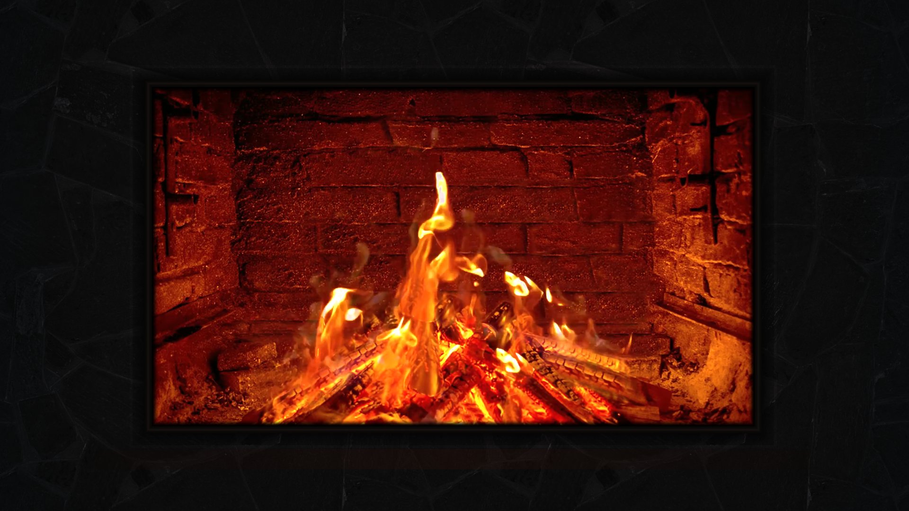
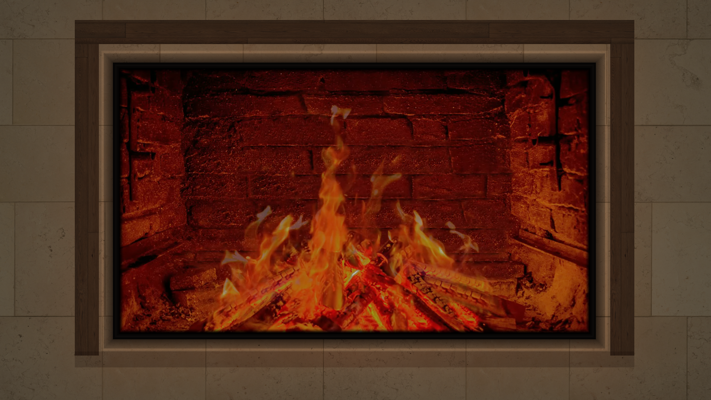
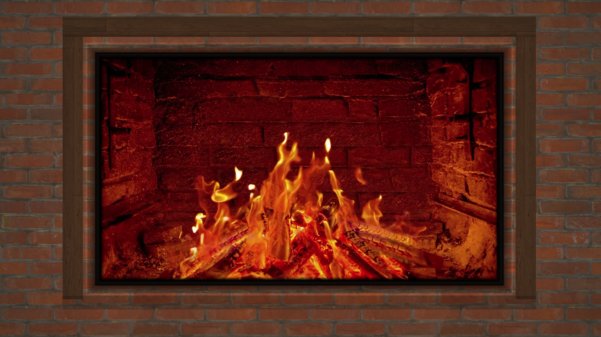

<p align="center">
  <a href="https://github.com/jeremykenedy/twilight-hearth#gh-light-mode-only"><picture><source media="(max-width: 600px) and (prefers-reduced-motion: reduce)" srcset="art/banner-mobile-still-light.bb5d13fe765e.svg"><source media="(prefers-reduced-motion: reduce)" srcset="art/banner-still-light.348ea3cac110.svg"><source media="(max-width: 600px)" srcset="art/banner-mobile-light.c1c623d6d0e4.svg"></picture></a>
  <a href="https://github.com/jeremykenedy/twilight-hearth#gh-dark-mode-only"><picture><source media="(max-width: 600px) and (prefers-reduced-motion: reduce)" srcset="art/banner-mobile-still-dark.60eca254883c.svg"><source media="(prefers-reduced-motion: reduce)" srcset="art/banner-still-dark.e6398aeb0d35.svg"><source media="(max-width: 600px)" srcset="art/banner-mobile-dark.5d185b657645.svg"></picture></a>
</p>

<p align="center">Real wood fire and quiet architectural surrounds for Fire TV, Android TV, and Google TV.</p>

<p align="center">
    <a href="https://github.com/jeremykenedy/twilight-hearth/releases"></a>
    <a href="https://github.com/jeremykenedy/twilight-hearth/releases"></a>
    <a href="https://github.com/jeremykenedy/twilight-hearth/actions/workflows/ci.yml"></a>
    <a href="https://github.com/jeremykenedy/twilight-hearth/actions/workflows/style.yml"></a>
    <a href="https://github.com/jeremykenedy/twilight-hearth/actions/workflows/docs.yml"></a>
    <a href="https://github.com/jeremykenedy/twilight-hearth/actions/workflows/security.yml"></a>
    <a href="LICENSE"></a>
</p>

<p align="center">
    <a href="https://github.com/jeremykenedy"></a>
    <a href="https://github.com/jeremykenedy/twilight-hearth" title="Open the repository and click Star"></a>
    <a href="https://github.com/sponsors/jeremykenedy"></a>
</p>

<p align="center">Show some love by starring this repository on GitHub.</p>

## Table of contents

- [Privacy](#privacy)
- [Features](#features)
- [Requirements](#requirements)
- [Installation](#installation)
- [Configuration](#configuration)
- [Fire TV Toolkit](#fire-tv-toolkit)
- [Screenshots](#screenshots)
- [Building and testing](#building-and-testing)
- [Documentation](#documentation)
- [Release notes](#release-notes)
- [Project policies](#project-policies)
- [License](#license)

## Privacy

The app requests no network permission and makes no network requests. It includes no ads, analytics, telemetry, crash reporting, or tracking. The standalone installer contacts GitHub only when you ask it to download a release APK and checksum. It sends no device or usage data.

## Features

Version 1.1.0 replaces the original painted fire with recorded wood fire. Native emulator and physical Fire TV checks are recorded in [device verification](docs/VERIFICATION.md).

| Feature | What it does | Guide |
| --- | --- | --- |
| Recorded wood fire | Offline 1080p flames with separate embers and reflected light | [Architecture](docs/ARCHITECTURE.md) |
| Three surrounds | Photographed brick, stone and modern dark slate | [Configuration](docs/CONFIGURATION.md) |
| Independent controls | Flame exposure, playback speed, embers and room lighting | [Configuration](docs/CONFIGURATION.md) |
| Quiet drift | Very slow movement across the whole fireplace | [Architecture](docs/ARCHITECTURE.md) |
| Native TV integration | Remote settings, offline credits, Preview and DreamService | [Integration](docs/INTEGRATION.md) |

## Requirements

- Android 6.0 (API 23) or later.
- OpenGL ES 2 graphics, H.264 decoding and a device that exposes Android's DreamService screensaver settings.
- Android SDK platform 36 and build-tools 36.0.0 to build from source.

Native support has been tested on the Android TV emulator listed in [device verification](docs/VERIFICATION.md). The exact final APK also passed bounded physical Fire TV AFTDEC012E/API30 checks. Google TV hardware remains unverified.

## Installation

Connect the TV or emulator with ADB and run `python3 install.py --serial DEVICE`. The installer downloads the latest signed release, verifies its published SHA-256 checksum, and installs or updates the app. Select Twilight Hearth in the device's screensaver settings afterward. The installer does not change system settings.

To remove the app, run `python3 install.py --serial DEVICE --uninstall --yes --force`. See [installation](docs/INSTALLATION.md) for local APK installation and safety details.

## Configuration

Open Twilight Hearth from the TV launcher and use the remote to adjust settings. Changes take effect the next time the screensaver starts. See [configuration](docs/CONFIGURATION.md) for supported values and the settings-provider interface.

## Fire TV Toolkit

[Fire TV Toolkit](https://github.com/jeremykenedy/fire-tv-toolkit) provides guided installation and TV setup:

```bash
git clone https://github.com/jeremykenedy/fire-tv-toolkit.git
cd fire-tv-toolkit
node setup.js
firetv-screensavers --install=twilight-hearth
screensaver --set=twilight-hearth
firetv-screensavers --uninstall=twilight-hearth --force
```

Run the install command again to update the same package with its existing signer. It installs the latest published release. Toolkit also manages supported launcher choices, sleep/screensaver timers and settings safeguards. Visual options live in this app; Fire TV UI discovers installed dreams and provides its documented settings/preview integration. See the [developer integration contract](docs/INTEGRATION.md) for exact identifiers and candidate limits.

## Screenshots

<table><tr><td></td><td></td><td></td></tr></table>

The first two 1920x1080 captures are from the exact signed 1.1.0 APK on a physical Fire TV AFTDEC012E/API30. The brick capture is from the same renderer on the Google TV API34 emulator. See the [native gallery](docs/GALLERY.md) and [device verification](docs/VERIFICATION.md) for current settings, credits, control checks, artifact hashes and limits.

## Building and testing

```bash
bash build.sh
bash test.sh
bash scripts/test-python-coverage.sh
bash scripts/test-coverage.sh
```

The app uses the Android SDK and JDK without third-party runtime dependencies. See [building](docs/BUILDING.md), [testing](docs/TESTING.md), and [architecture](docs/ARCHITECTURE.md).

## Documentation

- [Installation, update, and removal](docs/INSTALLATION.md)
- [Configuration and host integration](docs/CONFIGURATION.md)
- [Developer integration contract](docs/INTEGRATION.md)
- [Building from source](docs/BUILDING.md)
- [Architecture](docs/ARCHITECTURE.md)
- [Testing and coverage](docs/TESTING.md)
- [Device verification](docs/VERIFICATION.md)
- [Native gallery](docs/GALLERY.md)
- [Quality correction and verification limits](docs/QUALITY-AUDIT.md)
- [CI](docs/CI.md)
- [Troubleshooting](docs/TROUBLESHOOTING.md)
- [Release process](docs/RELEASING.md)

## Project policies

- [Contributing](CONTRIBUTING.md)
- [Security reporting](SECURITY.md)

## Release notes

- [Changelog](CHANGELOG.md)
- [Version 1.1.0](docs/releases/v1.1.0.md)
- [Version 1.0.0](docs/releases/v1.0.0.md)

## License

Twilight Hearth is licensed under the [Apache License, Version 2.0](LICENSE). Recorded fire is CC BY 3.0 and photographed materials are CC0. See [NOTICE](NOTICE), [media provenance](assets/media.json) and [material provenance](assets/materials/provenance.json) for attribution and exact hashes. Full application licenses and credits are also available offline in settings.
